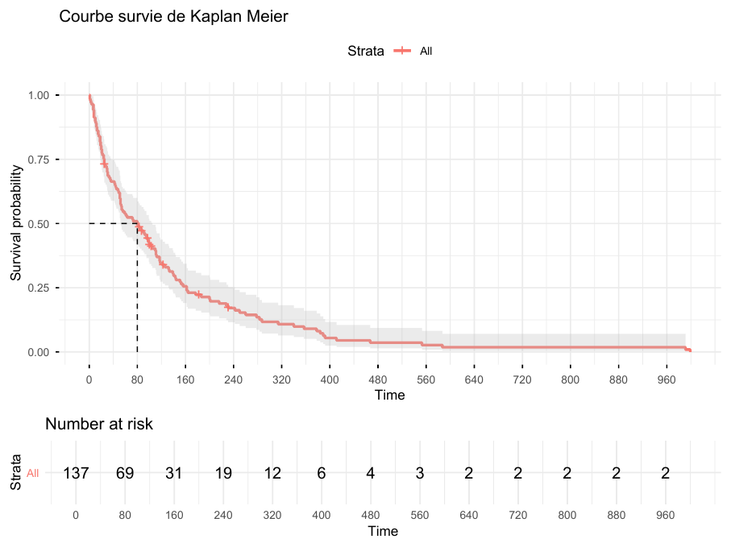
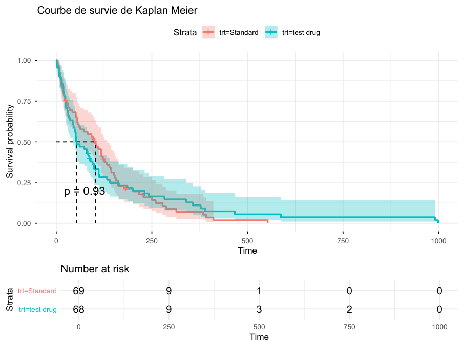
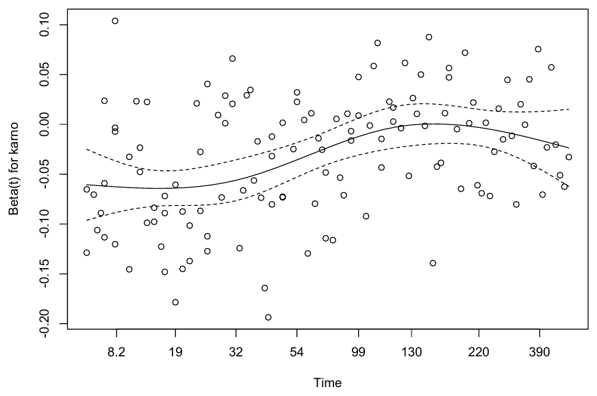
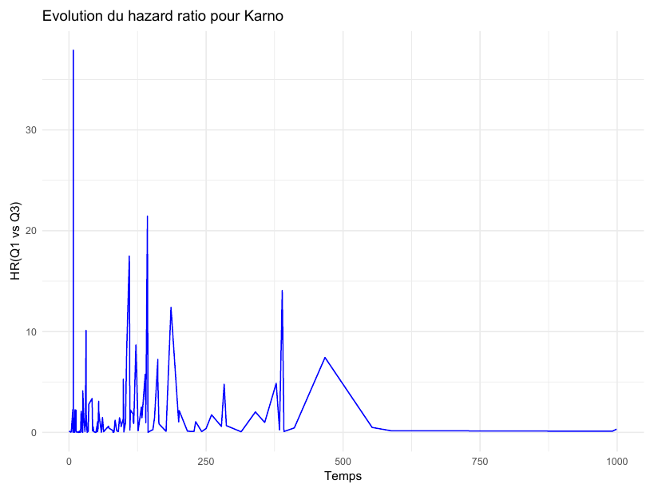

# Analyse de survie des patients atteints d'un cancer du poumon

Analyse du jeu de données `veteran` du package `survival` : 137 patients d'un essai randomisé comparant un traitement standard et un traitement test du cancer du poumon. L'événement étudié est le décès.

## Données

| Variable | Description |
|---|---|
| `trt` | traitement (standard, test) |
| `celltype` | type de cellule tumorale (squamous, smallcell, adeno, large) |
| `time` | temps de survie en jours |
| `status` | 1 = décès, 0 = censuré |
| `karno` | score de Karnofsky (100 = bon état général) |
| `diagtime` | mois entre le diagnostic et la randomisation |
| `age` | âge en années |
| `prior` | traitement antérieur (0 = non, 10 = oui) |

128 patients sur 137 sont décédés pendant le suivi, soit un taux de censure à droite de 6,5 %.

## Démarche

1. Estimation de la fonction de survie par Kaplan-Meier, globale et par traitement, et test du log-rank.
2. Modèle de Cox avec toutes les covariables.
3. Vérification de l'hypothèse des risques proportionnels par les résidus de Schoenfeld.
4. Modèle de Cox avec un effet du score de Karnofsky constant par morceaux sur trois périodes (0-90, 90-200 et plus de 200 jours).

## Résultats



*Courbe de survie globale (Kaplan-Meier).*

La survie médiane est de 80 jours. Moins de 5 % des patients sont encore en vie 400 jours après la randomisation.



*Courbes de survie par traitement.*

La survie médiane est de 103 jours dans le groupe standard et de 53 jours dans le groupe test, mais les courbes se croisent vers 160 jours et le test du log-rank ne montre pas de différence significative (p = 0,9).

Dans le modèle de Cox complet, seuls le type cellulaire et le score de Karnofsky ont un effet significatif. Le test de Schoenfeld rejette l'hypothèse des risques proportionnels (p global = 3,2e-05), à cause de ces deux variables.



*Résidus de Schoenfeld pour le score de Karnofsky.*



*Hazard ratio entre le premier et le troisième quartile du score de Karnofsky au cours du suivi.*

L'effet du score de Karnofsky est fort au début du suivi puis s'atténue. Le modèle final estime un effet différent sur chaque période :

| Variable | exp(coef) | p-value |
|---|---|---|
| celltype smallcell | 2,39 | 1,1e-03 |
| celltype adeno | 2,92 | 3,6e-04 |
| celltype large | 1,38 | 0,25 |
| karno | 0,96 | 8,4e-14 |
| karno × période 90-200 jours | 1,06 | 3,3e-05 |
| karno × période > 200 jours | 1,04 | 9,3e-03 |

Les termes d'interaction multiplient l'effet de la première période. Le hazard ratio du score de Karnofsky sur chaque période est donc :

| Période | HR pour 1 point | HR pour 10 points |
|---|---|---|
| 0-90 jours | 0,96 | 0,63 |
| 90-200 jours | 1,01 | 1,14 |
| > 200 jours | 1,00 | 0,96 |

Pendant les 90 premiers jours, 10 points de score en plus réduisent le risque de décès d'environ 37 %. Au-delà, le score mesuré à l'inclusion n'a plus d'effet net.

Par rapport au type squamous, le risque de décès est multiplié par 2,39 pour le type smallcell et par 2,92 pour le type adeno. Le type large ne diffère pas significativement. Le traitement n'a pas d'effet significatif sur la survie.

## Fichier

- `veteran_analyse_surv.R` : code complet

## Packages

```r
install.packages(c("survival", "survminer", "ggplot2", "knitr", "kableExtra", "skimr", "tidyverse", "broom"))
```
